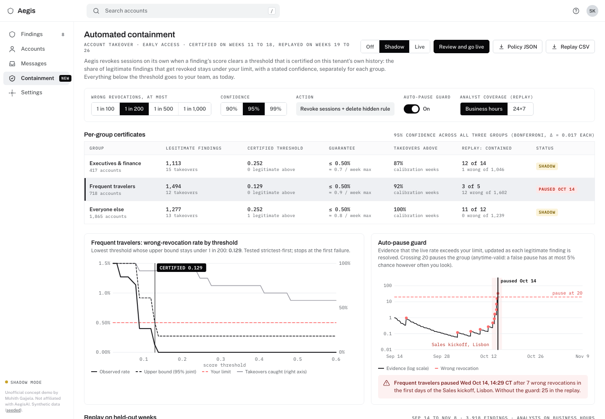

# Calibrated automated containment for AegisAI account takeover

**Live demo:** https://mohith26.github.io/aegisai-calibrated-containment/

AegisAI's account takeover protection is review-only today; its own FAQ says *"Automated containment is next."* The hard part of that step is not calling the revoke-sessions API, it is deciding **when** Aegis may act without a human. This concept answers that with a guarantee instead of a confidence bucket: the security team states a limit ("at most 1 in 200 legitimate findings may get its sessions revoked"), Aegis certifies the lowest score threshold that meets the limit on the tenant's own resolved findings (Learn-then-Test with exact binomial tests, separately for executives and finance, frequent travelers and everyone else), acts on the running score the moment it crosses, and pauses a group on its own when an anytime-valid guard sees live behaviour drift away from the calibration weeks.



## Results (seeded synthetic tenant, 8 held-out weeks)

3,000 mailboxes, 26 weeks, 12,727 findings, 117 confirmed takeovers. Score model trained on weeks 1-10, thresholds certified on weeks 11-18, everything below replayed on weeks 19-26 (3,918 findings, 31 takeovers). Limit 1 in 200, 95% joint confidence, analysts on business hours. Every number comes from `scripts/report.mjs` → `data/results.json` and is recomputed in the browser from the same code.

| Policy | Takeovers contained automatically | Median time to containment | Attacker steps prevented | Analyst reviews | Wrong revocations |
|---|---|---|---|---|---|
| Review only (today) | 0 of 31 | 2 h 17 min | 9 of 43 | 96 | 0 |
| Fixed score ≥ 0.90 | 7 of 31 | 51 min | 10 of 43 | 89 | 0 |
| Calibrated, no guard | 28 of 31 | 10 min | 25 of 43 | 42 | 26 |
| **Calibrated + guard** | **26 of 31** | **10 min** | **24 of 43** | **57** | **13** (0.33% of 3,887 legitimate) |

- The certificate holds where its assumption holds: on the seven replay weeks without the Lisbon sales kickoff, every group's wrong-revocation rate is under 1 in 200 (unit test).
- The Lisbon kickoff (week of Oct 12) is a deliberate distribution shift: conference Wi-Fi behind a cloud proxy, phones roaming mid-session, laptops still on the home VPN. It looks like token theft. The guard paused only *Frequent travelers* on Wed Oct 14, 14:29 CT; without it the replay has 26 wrong revocations instead of 13.
- With 24×7 analysts instead of business hours, review-only containment improves to a median 37 min; calibrated stays at 10 min.
- "Attacker steps" are inbox rules, MFA method registrations and internal phishing bursts that happened after the first malicious sign-in; a step counts as prevented if containment came first.

## How it works (`src/containment.js`)

1. **Signals from raw events.** Each finding carries its event trail (sign-ins with city, ASN type, device and session token; MFA push denials; MFA method registrations; inbox rules; internal send bursts). `featurize()` derives 16 signals the way an analyst would: travel speed (haversine / minutes since the last normal sign-in, > 900 km/h), first-seen device, hosting provider for an account with no VPN habit, one session token from two IPs, hidden rules (moved to RSS Subscriptions / Archive and marked read), payment keywords, first rule ever, internal bursts, off-hours.
2. **Running score.** A logistic model (stand-in for Aegis's own confidence score) is evaluated after every event, so containment can trigger at the sign-in, at the rule, or later. The trigger "running score crosses λ" is the same event as "max score ≥ λ", so certifying on each finding's maximum score certifies the trigger exactly.
3. **Learn-then-Test.** For group *g* with limit α, test H₀(λ): FPR(λ) > α on a fixed grid λ = 1.000, 0.999, … with p(λ) = P(Bin(n, α) ≤ k(λ)), where *k* is the number of legitimate calibration findings at or above λ. Fixed-sequence testing (strictest first, stop at the first p > δ/3) controls the family-wise error at δ/3 per group, so all three certificates hold jointly with probability ≥ 1 − δ (Bonferroni). If even k = 0 cannot certify α (n < log δ / log(1 − α)), the group stays review-only and the UI says how much history it needs.
4. **Replay.** Held-out findings are replayed in time order: audit-log delay (lognormal, median 4 min, assumption) + 5 s API call for automation; for everything else the finding enters the analyst queue when the score reaches 0.10 (the "Likely takeover" bar in this demo) and an analyst acts after a lognormal delay (median 38 min in business hours, otherwise the next 08:00 CT plus a median 25 min; assumptions, switchable to 24×7).
5. **Guard.** For each group, resolved legitimate findings feed a mixture likelihood-ratio e-process testing FPR ≤ α against 2α, 4α and 8α. Under the null every component is a nonnegative supermartingale, so by Ville's inequality the chance of a false pause, however often you look, is at most 5%. Crossing 20 pauses that group only.

The demo is the Aegis console as AegisAI shows it on `/platform/account-takeover-protection` (Findings / Accounts / Messages / Settings, dark Aegis side panel, verdict card), with a new **Containment** page, containment state on every finding, and a containment timeline on the finding detail. Shadow mode, an approval step for going live, analyst labels that update the guard, URL deep links (`#/containment?a=500&c=99&g=exec`), localStorage persistence, CSV and JSON export, and keyboard shortcuts (`/`, `j`/`k`, `Enter`, `Esc`, `g f`, `g c`, `[ ]`, `?`).

## Tests

```
node --test test/containment.test.mjs
```

14 tests: binomial tail, log-gamma and Clopper-Pearson inversions; minimum sample size; LTT refusing to certify thin history; monotonicity in α; a **randomised property test** (400 trials with a known score distribution) that the realised wrong-revocation rate exceeds α in at most δ of trials; a randomised test that the guard's false-pause rate stays under 5% at the limit and that it trips fast at 8× the limit; the travel/rule signals reproduced from raw events; first-crossing ≡ max-score; the certificate holding on non-shift replay weeks; and a **headline-number test** that recomputes `data/results.json` from data + code. A GitHub Actions workflow that runs them on every push is committed at `ci/test.yml`; it moves to `.github/workflows/` once the publishing token has the `workflow` scope.

## Run it

```
node scripts/generate.mjs   # data/tenant.json (seed 20261108)
node scripts/report.mjs     # data/results.json
python3 -m http.server      # then open http://localhost:8000
```

No build step; the page is static HTML/CSS/JS and loads in well under 2 s (the in-browser model fit and replay take about 0.5 s).

## Honest limitations

- **Synthetic data.** No real tenant data. Volumes, technique mix and delays are assumptions, except the 31% token-theft share of MFA-bypass attacks (Verizon DBIR 2025, as cited on aegisai.com). Real findings will be messier and the numbers above are not a forecast.
- **My score, not Proteus.** The logistic model is a stand-in. The method only needs Aegis's existing score; a better score gives a lower certified threshold and more automation at the same limit.
- **Exchangeability.** The certificate assumes the next weeks look like the calibration weeks. The guard limits the damage when they do not, but it reacts after wrong revocations, not before (7 happened in Lisbon before the pause).
- **Labels.** Calibration needs resolved findings. Unreviewed findings treated as legitimate make the bound conservative; takeovers mislabelled as legitimate would make it optimistic.
- **Group-level, not per-person.** The guarantee is a rate over a group's legitimate findings. It does not promise that a particular executive is never signed out.
- **Revoke sessions is the mildest action.** Password reset or account disable would need their own, stricter limits.

## Prior art and what is new

- Abnormal Security auto-remediates account takeover and, since May 2026, lets admins choose actions per **High/Medium/Low confidence** level. Microsoft Entra ID Protection ties actions to low/medium/high user risk. Neither states what error rate a level corresponds to on your tenant.
- Learn-then-Test (Angelopoulos, Bates, Candès, Jordan, Lei, 2021) and conformal risk control give distribution-free guarantees for choosing thresholds; e-processes and Ville's inequality give anytime-valid monitoring (Ramdas et al.). I could not find them applied to automated incident response or identity containment.
- AegisAI's site and changelog-style pages (platform, account takeover, Proteus launch, Oct-Nov 2026) describe review-only ATO with recommended steps; I found no announced containment policy, calibration or guard.

Unofficial concept demo by Mohith Gajjela. Not affiliated with AegisAI. Synthetic data.
